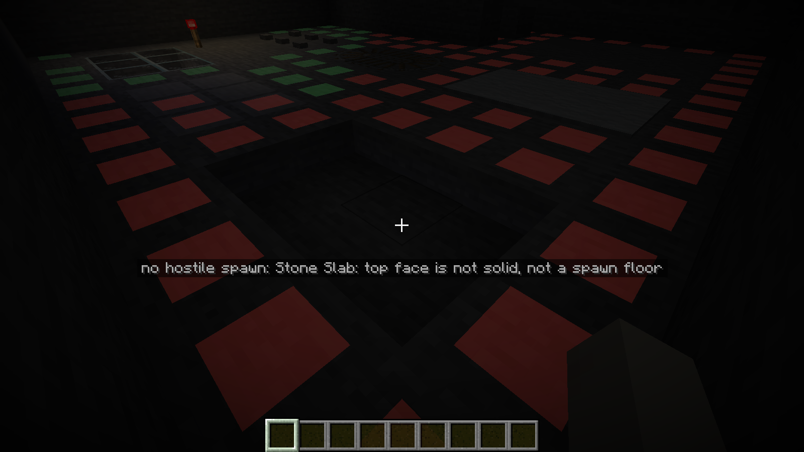
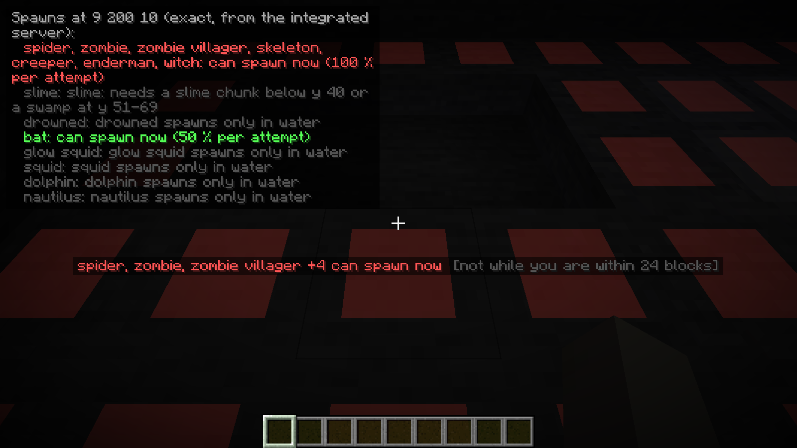

# Spawnsight

A client-side mob spawn planner for Minecraft 26.3 (Fabric).

Light-level overlays show numbers; Spawnsight answers the real question: **can a mob spawn on this
block, and which one?** It colours every block around you by what can spawn there, explains why or why
not for the block you look at, and draws the 24/32/128-block spawn and despawn spheres. Use it to
spawn-proof a base or to design a mob farm.

## What you see

| Colour | Meaning |
|---|---|
| **Red** | A hostile mob can spawn here **now**. |
| **Yellow** | A hostile mob can spawn here only **sometimes**: at night, in a thunderstorm or in another moon phase. |
| **Purple** | Only slimes could spawn here, if this is a slime chunk: the world seed is unknown (on a server, see `/spawnsight seed`). |
| **Green** | A passive, ambient or water mob can spawn here (optional layer). |
| nothing | No natural spawn is possible here. |

Blocks within 24 blocks of you are drawn smaller and fainter: nothing spawns that close to a player, so
they show what would spawn there **when you are away**. Turn on *Strict 24-block rule* to hide them
instead.

- **Why panel** (`I`): every mob in the spawn list of the aimed block, with its chance per spawn
  attempt or the rule that stops it: `block light 3 > 0`, `Stone Slab: top face is not solid`,
  `only 1 block of space`, `no room for the spider (1.40 wide)`, `too bright at night: light 9 > 7`.
  A one-line hint under the crosshair says the same in short.
- **Spheres** (`Y`): 24 blocks (no spawning closer), 32 (random despawn starts), 128 (instant despawn).
- **Farm mode**: `/spawnsight mob minecraft:enderman` shows only where that mob can spawn;
  `/spawnsight mob all` shows everything again.

## How exact is it?

Spawnsight implements the natural spawn rules of 26.3 as read from the game's code: the spawn
placement type, the floor (`isValidSpawn`, so slabs, glass, leaves, trapdoors, glowing blocks and
blocks from other mods are right), two blocks of non-solid, fluid-free, non-redstone space, the
mob's real hitbox (spiders need 3×3, endermen 3 high, slimes 2.08 wide), light (block light 0 for
monsters, sky light and time of day, thunderstorms, the moon for swamp slimes), the dimension's rules,
biome spawn lists, structure spawns and slime chunks, and the checks a mob does after it is created.
Some combinations are surprising and are shown as they are: zombie horses only spawn on grass blocks,
and camel husks never spawn on desert sand.

- **Singleplayer and LAN host**: the spawn lists, structures (witch huts, monuments, outposts,
  fortresses), data packs and the seed come from the integrated server. Exact.
- **On a server**: the client does not receive the spawn lists, structures or seed. Spawnsight uses the
  vanilla 26.3 spawn tables, so **data packs and server plugins that change spawns are not known**, and
  structure spawns are not shown (nether bricks in the Nether are assumed to be a fortress). Slime chunks
  are unknown until you enter the world seed with `/spawnsight seed <seed>`. The panel and the HUD say
  when this applies.

It shows whether a spawn is **possible**, with its chance per attempt. How often mobs actually appear
also depends on the mob caps, the random choice of position and the spawn potential in soul sand
valleys and warped forests. Entities standing in the way are not checked.

A self-test compares Spawnsight with the game's own spawn checks on a test rig (930 blocks, every mob
in the lists, 600 random draws each: no differences) and watches the server spawn mobs naturally: every
mob spawned on a block Spawnsight marked as possible now.

## Keys and commands

| Key | Action |
|---|---|
| `U` | Overlay on / off |
| `I` | Why panel for the block you look at |
| `Y` | Spawn and despawn spheres |

All keys can be changed in Controls → Spawnsight.

| Command | |
|---|---|
| `/spawnsight` | Overlay on / off |
| `/spawnsight why` | The why panel's text in chat |
| `/spawnsight mob <entity>` / `all` | Farm mode: only one mob / all mobs |
| `/spawnsight seed <seed>` / `clear` | World seed on a server, for slime chunks (stored per server) |
| `/spawnsight radius <4-64>` | Blocks around you that are checked |
| `/spawnsight stats` | Scanner numbers |
| `/spawnsight config` | Settings (also in Mod Menu) |
| `/spawnsight help` | This list |

## Settings

Overlay, radius, yellow layer, green layer, strict 24-block rule, spheres, aim hint, opacity and the scan
budget (time per tick the scanner may use), each with a tooltip. Files: `config/spawnsight/config.json`
and `config/spawnsight/seeds.json`.

## Performance

Blocks are checked per 16×16×16 section, only when a section changes (blocks, light, chunk loading),
when the time of day or weather changes the result, or when settings change. The work is spread over
ticks with a time budget (2 ms per tick, more while catching up), nearest sections in front of you
first. On the test machine radius 32 filled in about 6 s using about 0.5 s of CPU in total, and the
overlay needs about 4 KB per section that has colour.

## Building

JDK 25. `./gradlew build` runs the unit tests and generates the vanilla spawn table from the game jar.
Self-tests: `./gradlew runClient -Pselftest=m1|m2|m4|m5|shots` (see `PLAN.md` §10 for the worlds they use).

## License

MIT. By Skaffa and Claude (Anthropic).
